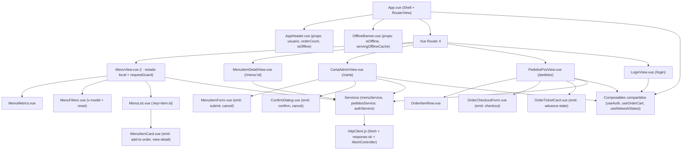
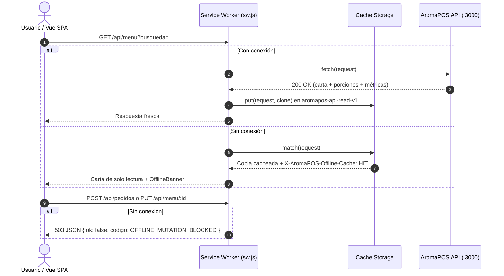

# Informe Técnico: Aplicación SPA/PWA AromaPOS con Vue 3 y Consumo de API REST

**Proyecto:** AromaPOS · Gestión de Carta, Pedidos POS y Cocina para Cafetería  
**Stack:** Vue 3 (Composition API `<script setup>`), Vue Router 4, Tailwind CSS v4, Vite 6, Fetch API, Service Worker nativo y Web App Manifest.  
**Backend Equivalente:** API REST Node.js (`server/cafe-api.mjs`) con persistencia JSON local y contrato REST uniforme.

---

## 1. Arquitectura de Componentes y Gestión de Estado

La aplicación organiza su interfaz bajo un flujo unidireccional (**props hacia abajo, eventos hacia arriba**) dividiendo claramente las responsabilidades entre vistas de ruta, componentes reutilizables, servicios HTTP y composables transversales:

- **Estado local por defecto:** La búsqueda, el filtro por categoría, el listado de ítems de la carta, el detalle por `:id`, el tablero de tickets y los borradores de formularios se mantienen locales en cada vista/componente (`MenuView.vue`, `MenuItemDetailView.vue`, `CartaAdminView.vue`, `PedidosPosView.vue`, `MenuItemForm.vue`).
- **Estado compartido únicamente cuando es necesario:** Se restringe a cuatro composables mínimos: `useAuth.js` (sesión de turno compartida entre barra superior, CRUD y POS), `useOrderCart.js` (comanda activa persistida en `localStorage`), `useNetworkStatus.js` (estado online/offline, caché y `beforeinstallprompt`) y `useToast.js` (notificaciones).
- **Estados UI explícitos y listas con claves estables:** Todas las vistas cubren `loading`, `success`, `empty` y `error` mediante `StateFeedback.vue`, y cada `v-for` utiliza identificadores únicos estables (`:key="item.id"`, `:key="item.producto.id"`, `:key="pedido.id"`).

---

## 2. Estrategia de Consumo HTTP y Prevención de Condiciones de Carrera

Todas las peticiones HTTP están centralizadas en `src/services/httpClient.js` (`httpRequest`), utilizado exclusivamente por `authService.js`, `menuService.js` y `pedidosService.js`:

1. **Sesiones `httpOnly` y proxy:** Las solicitudes incluyen `credentials: 'include'` hacia `/api` (enrutado por el proxy de Vite a `http://localhost:3000` o mediante `VITE_API_BASE_URL`), manteniendo la cookie `connect.sid` sin exponer tokens en JavaScript.
2. **Validación estricta de `response.ok` y manejo uniforme de errores:** `httpRequest` verifica `if (!response.ok)` y `payload.ok === false`, lanzando `ApiError` con `status`, `codigo`, `mensaje` y `detalles`. Esto permite presentar fallos `400 VALIDACION_FALLIDA`, `401 NO_AUTORIZADO`, `404 NOT_FOUND` y `409 CODIGO_DUPLICADO` / `PORCIONES_INSUFICIENTES` directamente en los formularios mediante `mapServerValidationErrors`.
3. **Prevención de condiciones de carrera (*Last-One-Wins*):** `createLatestRequestGuard()` combina un `AbortController` activo con un contador monotónico `latestSeq`: al iniciar una nueva búsqueda o cambiar de ruta `:id`, aborta la solicitud anterior (`signal.abort()`) e ignora cualquier respuesta tardía (`seq !== latestSeq`). Adicionalmente, `useAuth.js` usa `authEpoch` para evitar que una verificación inicial `/api/auth/me` sobreescriba un inicio de sesión posterior, y las mutaciones bloquean envíos concurrentes con banderas `submitting`.

---

## 3. Estrategia PWA: Manifest y Caché Offline Limitada y Segura

La aplicación incluye `public/manifest.webmanifest` (`display: "standalone"`, `start_url: "/"`, iconos PNG `192x192`, `512x512` y `maskable`) y registra `public/sw.js` vía `src/pwa/registerSw.js`. En build, `vite.config.js` (`pwaPrecacheAssetsPlugin`) inyecta los archivos JS/CSS con hash en `BUILD_ASSETS` dentro de `dist/sw.js`.

| Recurso / Ruta | Estrategia SW | Caché | Comportamiento Offline |
|---|---|---|---|
| App Shell (`/`, `/index.html`, JS, CSS, iconos, manifest) | **Cache-First** (Assets) / **Network-First** (Navegación SPA) | `aromapos-shell-v1` | Renderizado completo de la interfaz y navegación SPA |
| Consulta de carta (`GET /api/menu`, `GET /api/menu/:id`) | **Network-First** (solo `response.ok`) | `aromapos-api-read-v1` | Devuelve última carta cacheada con cabecera `X-AromaPOS-Offline-Cache: HIT` |
| Autenticación (`/api/auth/*`), Pedidos (`/api/pedidos*`) y CSV | **Network-Only** (sin caché) | Ninguna | Nunca almacena sesiones ni comandas volátiles; devuelve `503` controlado |
| Mutaciones (`POST`, `PUT`, `PATCH`, `DELETE`) | **Network-Only** (sin cola offline) | Ninguna | Bloqueadas en UI y por SW (`503 OFFLINE_MUTATION_BLOCKED`) para evitar sobreventa |

Durante el evento `activate`, el Service Worker limpia versiones obsoletas de caché y reclama clientes, garantizando una experiencia instalable, coherente y segura.
